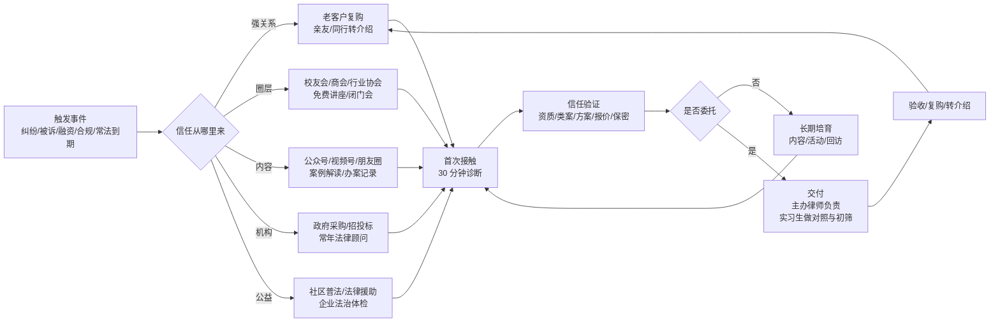
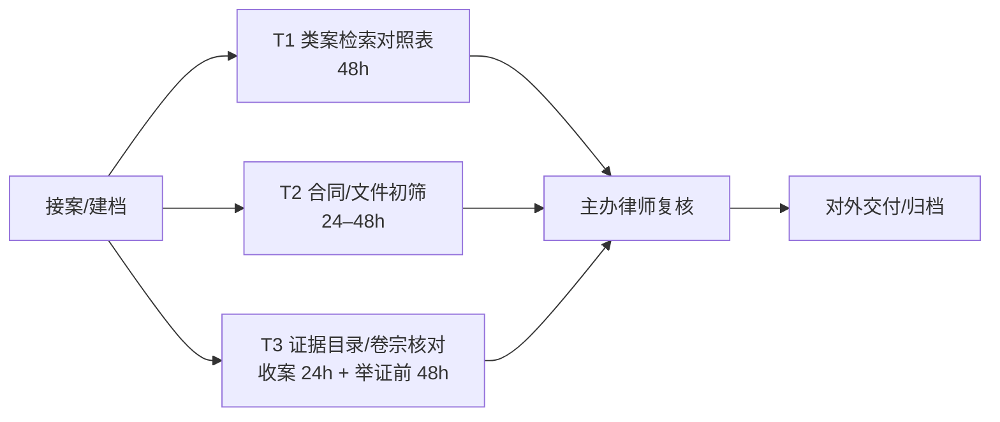

# T15 · 律师行业流程探针：信任获客 + 实习生承接

- task_id: T15 ｜ owner: W15 ｜ date: 2026-11-21 ｜ status: **UNVERIFIED**
- 范围: 只读公开网页（律协规则、司法行政机关公告、政府采购公告、律所公开文章、律所招聘页、法院公开指引）；**未访谈任何律所、未联系任何客户、未接触案件材料**。
- 结论: 拆出 **5 个获客渠道**、**3 个实习生任务**、**1 个可替代环节**；9 条均带来源。真实流程访谈 **0/1**，因此整体仍为 `UNVERIFIED`。
- 探针成本: **¥0 / 3h**（无付费数据库、无广告、无采样例）；公开资料整理约 2.5h。
- 证据级别: **A**=法律/行业规则、法院指引、政府采购公告等一手可核；**B**=律所/行业机构公开文章或招聘页（自述，可核但可能有营销偏差）；**C**=行业二手报告/媒体转述；**D**=访谈原话（本次 0 条）。

> 本文件只交付「律师怎么被信任、实习生怎么承接」，不交付法律意见，也不冒充律师。
> 所有“律所怎么做”的句子都限定为“该所公开页面这样写”，不推断为全行业事实。

## 一、获客路径图（先信任，后案源）

**路径的 6 个卡点**（任何一环断了，案源都接不住）：

| # | 卡点 | 客户真实问题 | 律师要给的东西 | 来源 |
|---|---|---|---|---|
| 1 | 触发 | “我现在要不要找律师？” | 先判断紧急度，不急着报价 | 申浩公开文章：客户前 10 分钟已在判断要不要委托 |
| 2 | 信任源 | “凭什么信你？” | 熟人背书 / 机构资质 / 可核案例 / 公益记录 | 坤澜公开文章：熟人网络、行业圈层、律所品牌降低信任门槛 |
| 3 | 首次接触 | “你听懂我的事了吗？” | 30 分钟诊断，复述事实与争议焦点 | 申浩公开文章：先研究客户需求，再谈方案 |
| 4 | 信任验证 | “你和别人有什么不同？” | 类案对照、服务范围、交付物、时间表、报价 | 最高法类案检索意见；全国律协业务推广规则 |
| 5 | 委托 | “价格和风险怎么定？” | 书面委托、风险提示、利益冲突审查 | 上海律协委托手续指引（2026） |
| 6 | 交付/复购 | “下次还找你吗？” | 可验收的交付 + 复购/转介绍动作 | 申浩公开文章：维护 1 位老客户优于获取 10 位新客户 |

> 图中“实习生”只出现在交付端的后台，**不直接对客户出法律意见、不签字、不承诺结果**。

## 二、5 个获客渠道（逐条带来源）

| id | 渠道 | 谁推荐 / 信任源 | 什么内容建立信任 | 真实动作（可执行） | 成本/周期 | 合规红线 | 来源 | 级别 |
|---|---|---|---|---|---|---|---|---|
| C1 | **熟人 + 老客户复购/转介绍** | 老客户、亲友、前同事、同行律师；强关系背书 | 过去交付结果、口碑、可核的类案经验、透明报价；不是“认识很多人” | 结案 7 天内复盘；3 个月回访；请客户在**具体场景**里引荐（“你同行遇到同类纠纷可以找我”），不做泛泛的“帮我介绍” | 现金成本低；周期 6–12 个月；老客户复购优先级高于拉新 | 不得支付案件介绍费、律师费收入分成（规则第 13 条）；未经客户许可不得发布客户信息（第 10 条第 9 项） | 申浩公开文章；温州行业报告；全国律协业务推广规则；坤澜公开文章 | B（规则 A；温州报告 C） |
| C2 | **专业内容 / 自媒体 / 朋友圈** | 算法与弱关系；同行转发；不是“推荐人”，是“被看见” | 脱敏办案记录、类案解读、新规拆解、可执行清单；不是“胜诉率”“专家人设” | 锁定 1 个细分领域；每周 ≥2 条，持续 6 个月；朋友圈按 70% 专业 + 20% 生活 + 10% 互动；每篇只解决一个具体问题 | 现金 ¥0；见效 6 个月起；转化难度高于朋友推荐 | 不得承诺办案结果、宣示胜诉率/赔偿额、自称专家；公众号/网站属业务推广，需亮明姓名、执业证号、所名（第 6/7/9/10 条） | 天同公开文章；坤澜公开文章；全国律协业务推广规则 | B |
| C3 | **行业圈层 / 商会 / 校友会 / 免费讲座** | 校友、商会/行业协会熟人、讲座主办方；圈层背书 | 免费讲座、法律咨询、行业风险清单；用一次具体帮助换信任，不是发名片 | 选 1 个目标行业；进入 1 个商会/校友会；每季度 1 次免费讲座或闭门会；会后 24h 发一页“风险清单 + 联系人” | 场地/差旅；周期 3–6 个月 | 不得在非履职活动中使用律协职务（第 10 条第 11 项）；不得暗示与机关有特殊关系（第 10 条第 3 项）；不得支付回扣/介绍费（第 10 条第 7 项、第 13 条） | 坤澜公开文章；申浩公开文章；全国律协业务推广规则 | B |
| C4 | **招投标 / 政府采购 / 常年法律顾问** | 采购方评审；机构信任，不是个人推荐 | 律所执业许可证、团队履历、同类业绩合同、服务方案、报价；可验证的交付能力 | 盯政府采购/公共资源交易平台；常备“资质包 + 同类业绩 + 服务方案”；逐条对照资格条款（如不接受联合体竞标、需提供同类业绩合同） | 标书 3–10 人日；周期 1–3 个月；示例预算 23.7 万元/年 | 不得串标/围标、虚假业绩；参与招标比选参照业务推广规则（第 18 条） | 深圳市委金融办 2025 年综合法律服务招标公告；全国律协业务推广规则；律讯网 | A（公告）+ B（平台） |
| C5 | **公益普法 / 法律援助 / 企业法治体检** | 社区、学校、司法所、公益组织、受助人；机构型信任 | 免费普法课、法律援助、企业法治体检、公益记录；可见的长期投入 | 与司法所/社区/学校/商会合作，每季度 1 场；课后只留“一页纸”清单，不硬推案源；记录服务时长 | ¥0–少量物料；周期 6–12 个月；直接转化弱、品牌信任强 | 法律援助案件除外可减免收费；不得把“不收费/减收费”作为业务推广手段（第 10 条第 8 项）；不得冒充律师、不得承诺结果 | 司法部/上海司法局公益法律服务意见；立方律所社会责任页；智仁线上公益普法课；全国律协业务推广规则 | A（政策）+ B（律所实践） |

**“谁推荐”按信任强度排序**（本探针的判断，不是行业统计）：

1. **强信任**：刚被服务过的老客户、亲友、同行律师——他们能说出“这个人具体做过什么”。
2. **中信任**：校友、商会/行业协会熟人、讲座主办方——有共同圈层，但仍需一次专业验证。
3. **弱信任**：内容平台/算法——只能带来“被看见”，不能替代“被相信”。
4. **机构信任**：政府采购评审、公益组织、社区/学校——信的是资质与记录，不是个人关系。

> 注意：公开文章里常把“案源费/介绍费”写成行业惯例，但全国律协规则明确禁止以支付案件介绍费、律师费收入分成与第三方合作推广。**本探针不把“付费买推荐”算作合规渠道。**

## 三、什么内容建立信任（不是“专业”两个字）

| 信任内容 | 证据形态 | 能说什么 | 不能说什么 | 来源 |
|---|---|---|---|---|
| **身份可核验** | 姓名 + 执业证号 + 所名；律所执业许可证号 | 执业年限、专业领域、收费标准、联系方式 | 不得与登记信息不一致；不得用“中国/中华/全国”等字样误导 | 全国律协业务推广规则第 6/7/10 条 |
| **类案能力** | 类案检索报告：检索主体/时间/平台/方法/结果、裁判要点、与本案异同 | “我们检索到以下类案，供你判断” | 不得把参考案例说成“必胜”；不得编造案号 | 最高法类案检索意见第 8 条；人民法院案例库 |
| **交付确定性** | 服务范围、交付物、时间表、谁承办、报价口径 | “这类事我们做哪几步、几天、谁来跟” | 不得承诺办案结果；不得宣示胜诉率 | 全国律协业务推广规则第 10 条；申浩公开文章 |
| **过程透明** | 证据目录、周报、节点确认单 | “现在到哪一步、还缺什么、下一步谁做什么” | 不得未经许可披露客户信息 | 全国律协商业秘密指引第 151.1 条；上海律协立卷归档指引 |
| **第三方背书** | 荣誉、评级、公益记录、行业协会任职 | 注明授予时间与授予机构 | 不得自称“公认专家/专家单位”；不得用律协职务做非履职宣传 | 全国律协业务推广规则第 8/9/10 条 |
| **边界感** | 风险提示、利益冲突审查、保密承诺 | “这个结论有不确定性，我们按阶段收费” | 不得暗示与司法机关有特殊关系；不得承诺“包赢” | 上海律协委托手续指引；全国律协业务推广规则 |

**一句话**：律师卖的首先不是“法律知识”，而是**可核验的身份 + 可对照的类案 + 可验收的交付 + 可承担的边界**。这四样才把“认识”变成“敢委托”。

## 四、实习生 3 个任务（对照 + 初筛）

**定位**：实习生是“对照层 / 初筛层 / 归档层”，不是“决策层”。
**总原则**：所有输出都必须能被主办律师在 10 分钟内复核；所有结论都写成“待律师确认”，不写成法律意见。

### T1 类案检索与对照表

| 项 | 要求 |
|---|---|
| 输入 | 起诉状/答辩状/合同/争议焦点（脱敏）；主办律师给的 3–5 个关键词 |
| 步骤 | ① 提取“主体 + 法律关系 + 争议焦点 + 诉请”；② 按顺位检索：指导性案例 → 典型案例 → 本省高院参考案例 → 上级/本院生效案件；③ 近 3 年优先；④ 去重；⑤ 做对照表；⑥ 写检索日志 |
| 对照表字段 | 案号、法院、裁判日期、案由、争议焦点、裁判要点、与本案**相同点**、**不同点**、可用性（高/中/低）、原文页码 |
| 输出 | 1 页对照表 + 1 页检索日志（平台/关键词/日期/结果数）+ 3–5 个精读案例 |
| 时限/数量 | 48h；10–15 个候选，精读 3–5 个 |
| 升级条件 | 找不到类案；类案裁判冲突；新类型/涉外/刑事；涉及客户机密边界 |
| 禁止 | 编造案号；把 AI 输出直接引用；把不同案由硬套；对客户说“肯定能赢” |
| 来源 | 最高法类案检索意见（检索范围/报告要素）；人民法院案例库；云亭律所招聘页（“检索法律及判例并撰写检索报告”） |
| 验收 | 每个案号可在案例库/裁判文书网复核；字段齐全；检索日志可复现；零编造 |

### T2 合同/法律文件初筛

| 项 | 要求 |
|---|---|
| 输入 | 合同/协议/律师函/法律意见书草稿；客户业务背景（只给必要部分） |
| 步骤 | ① 主体/签署/授权；② 金额/支付/发票；③ 期限/交付/验收；④ 违约/解除/赔偿；⑤ 管辖/争议解决；⑥ 保密/知识产权/数据；⑦ 与客户陈述不一致处；⑧ 红黄绿灯标注 |
| 输出 | 风险点清单：条款号 + 原文 + 风险等级 + “要问律师的问题” + “要客户补的材料” |
| 时限 | 24–48h；只做初筛，不写最终意见 |
| 升级条件 | 红点；重大金额；涉外；刑事；数据合规；交易结构变化 |
| 禁止 | 不出具法律意见；不替客户决策；不改交易结构；不承诺“可以签” |
| 来源 | 云亭律所招聘页（起草/审查合同、法律意见书）；湖南大学法学院律所招聘汇总（合同草拟及审查、文件校对）；全国律协业务推广规则（实习律师参照执业规范） |
| 验收 | 每个红点有原文页码；无“建议签/不签”结论；主办律师复核率 100% |

### T3 证据目录/卷宗核对与归档

| 项 | 要求 |
|---|---|
| 输入 | 证据原件/复印件/扫描件、证据目录、卷宗 |
| 步骤 | ① 目录 vs 实物逐项核对；② 查缺页/重页/倒页/模糊/日期矛盾/签章；③ 标原件/复印件；④ 按法院/仲裁要求排序装订；⑤ 扫描命名归档；⑥ 建“待补材料清单” |
| 目录七要素 | 证据序号、证据名称、证据形式、证据来源、证据页数、证据页码、证据拟证明的事实 |
| 输出 | 核对表 + 缺失清单（责任人/截止日）+ 归档目录 |
| 时限 | 收案后 24h 初核；举证前 48h 复核 |
| 升级条件 | 原件缺失；证据矛盾；超举证期限；客户无法补材料 |
| 禁止 | 不接触超出授权的客户机密；不擅自补造/修改证据；不对外发送 |
| 来源 | 全国律协商业秘密指引第 151.1 条（证据目录七要素）；上海律协立卷归档指引（2026）；云亭律所招聘页（收集整理证据、整理归档案卷） |
| 验收 | 目录与实物 100% 对应；缺失清单有责任人和截止日；扫描件可检索 |

**实习生 SOP 的 6 条铁律**：

1. 只接“已脱敏 + 主办律师书面授权”的材料；不接客户原始账户、密码、完整交易数据。
2. 所有输出首页写“实习生工作底稿，待主办律师复核，不构成法律意见”。
3. 每个结论必须能回到原文页码/案号/条款号；不能回源的，删掉。
4. 红点/冲突/新类型，当天升级，不自己扛。
5. 不直接加客户微信、不直接给客户发结论、不替律师报价。
6. 工作底稿、检索日志、复核记录随卷归档，方便复盘和追责。

## 五、可替代环节清单（1 个计入验收）

| id | 环节 | 现在谁做/耗时 | 可替代方式 | 人必须保留什么 | 验收标准 | 来源 |
|---|---|---|---|---|---|---|
| R1 | **类案检索的“初筛 + 字段化对照表”**（不是法律判断） | 实习生 2–3h/案；媒体口径“3 小时 → 2 分钟” | 脚本/AI 做关键词扩展、批量检索、去重、抽取案号/法院/日期/裁判要点、生成对照表初稿；实习生只做对照与回源 | 选案、相似性判断、裁判要点提炼、冲突处理、**每个案号回源核验**、对客户解释 | 20 个案号 100% 可在案例库/裁判文书网复核；对照表字段齐全；主办律师修改量 <30%；零编造案号/法条 | 海报新闻/华龙网（3h→2min，且文中记录 AI 编造案号）；司法部“充分合理利用 AI 工具”；最高法类案检索意见；云亭招聘页 |

**为什么只把 R1 计入**：它同时满足三个条件——① 输入/输出可结构化；② 错误可被“回源核验”抓住；③ 即使替代失败，主办律师仍能兜底。合同审查的“风险判断”、证据的“三性认定”、客户沟通与出庭，都不能替代。

**备选观察项（不计入本次验收）**：

- 卷宗扫描/OCR/重命名/归档：可脚本化，但涉及客户机密与原件管理，先做本地化、不上传。
- 合同条款与标准模板的“逐条对照”：可做初稿，但交易结构、商业判断必须律师做。

## 六、验收自检

| 验收项 | 结果 | 证据 |
|---|---|---|
| 5 个获客渠道 | **PASS 5/5** | 第二节 C1–C5，每条有来源 |
| 3 个实习生任务 | **PASS 3/3** | 第四节 T1–T3，每条有来源 + SOP |
| 1 个可替代环节 | **PASS 1/1** | 第五节 R1，含可替代边界与验收 |
| 每条带来源 | **PASS 9/9** | 第二、四、五节；来源清单第七节 |
| 不冒充律师 | **PASS** | 全文限定“公开页面这样写”；未以律师身份联系任何人 |
| 不索取客户机密 | **PASS** | 未联系客户；SOP 明确脱敏与授权边界 |
| 不承诺法律意见 | **PASS** | 所有输出标注“待主办律师复核，不构成法律意见” |
| 预算 ¥10 / 3h | **PASS（探针本身）** | 实际 ¥0；公开资料整理约 2.5h |
| 真实流程访谈 | **NOT DONE 0/1** | 本窗口无授权访谈对象；未伪造访谈记录 |

**结论**：公开证据层面 9/9 行达标；**真实流程层面仍为 UNVERIFIED**，因为“谁推荐、转化率、实习生实际耗时、错误率”必须由 1 家律所的访谈/旁听来确认。

## 七、来源清单（访问日 2026-11-21）

1. **全国律协《律师业务推广行为规则（试行）》全文** — https://www.shanghaiinvest.com/cn/viewfile.php?id=12615
   - 第 2 条推广方式；第 6/7 条身份与证号；第 8/9 条荣誉与专家；第 10 条 13 项禁止；第 13 条禁止案件介绍费/分成；第 18 条招标比选参照。
2. **湖南省司法厅转载司法部解读** — http://sft.hunan.gov.cn/sft/xxgk_71079/gzdt/sjdt/201803/t20180301_4963622.html
   - 15 种禁止推广行为；不得自称专家、不得承诺结果、不得回扣。
3. **北京市律协转发通知（律发通〔2018〕5 号）** — https://www.beijinglawyers.org.cn/cac/1517906659123.htm
   - 规则官方转发与 PDF 附件。
4. **最高人民法院《关于统一法律适用加强类案检索的指导意见（试行）》** — https://www.court.gov.cn/fabu/xiangqing/243981.html
   - 类案定义、检索顺位、近 3 年优先、检索报告要素（第 1/4/8 条）。
5. **人民法院案例库上线公告** — https://www.court.gov.cn/zixun/xiangqing/426222.html
   - 官方类案库，网址 https://rmfyalk.court.gov.cn。
6. **中国裁判文书网** — https://wenshu.court.gov.cn/
   - 案号/裁判文书回源核验。
7. **深圳市委金融办 2025 年度综合法律服务招标公告** — https://jr.sz.gov.cn/sjrb/xxgk/zjxx/zfcg/content/post_12305348.html
   - 预算 23.7 万元；服务期 1 年；综合评分法；同类业绩 10 分；团队/资质要求。
8. **律讯网（法律服务采购与招标平台）** — http://www.lvxunlaw.com/
   - 全国法律服务招标信息聚合（B 级商业平台，仅作入口）。
9. **天同律师事务所《那个玩自媒体的律师现在怎么样了？》** — https://www.tiantonglaw.com/Content/2024/10-31/1048212065.html
   - 自媒体获客路径；内容→连接→信任→转化；转化难度高于朋友推荐；每周 ≥2 条、坚持半年。
10. **上海申浩律师事务所《律师如何增加获客机会？》** — https://sunhold.com.cn/Cn/Index/pageView/catid/26/id/622.html
    - 老客户复购优于拉新；70% 时间展示专业价值；客户在哪里律师出现在哪里；风险代理比例高反映信任不足；案源费讨论（本探针不采纳为合规做法）。
11. **上海坤澜律师事务所《探索青年律师成长之路第一期「案源篇」》** — http://www.kunlanlaw.com/1904.html
    - 熟人网络；校友会/商会/行业协会；免费讲座/法律咨询；朋友圈 70/20/10；律所品牌降低信任门槛；内容输出建立专业标签。
12. **温州律师行业发展报告（2025）** — http://www.lvzhouls.com/Mobile/news/content/id/851.html
    - 70% 律所仍依赖关系推荐案源和低价竞争；数字化营销渗透率不足 15%；83.4% 企业客户更倾向“专业性强、沟通高效”的团队；AI 合同审查效率 +40%。
13. **司法部/上海市司法局《关于促进和规范律师参与公益法律服务的实施意见》** — https://sfj.sh.gov.cn/2020jcgk_gfxwj/20220314/59afbffe91f7471180007573ccf9583f.html
    - 公益法律服务 19 种形式；倡导每年 ≥50 小时或至少 2 件法律援助；公益与评先评优/法律顾问选聘挂钩。
14. **立方律师事务所社会责任页** — https://www.lifanglaw.com/cn/cnshzr/
    - 公益法律服务中心；公益巡回讲座；法律援助案件；未成年人保护手册。
15. **浙江智仁律师事务所线上公益普法课** — https://www.zhirenlawyer.com/zrjz-5.html
    - 线上公益普法课系列（合同风险、个人信息保护、生成式 AI 合规等）。
16. **北京云亭律师事务所招聘页（急聘律师助理/实习生）** — https://www.yuntinglaw.com/jobopp/237
    - 实习生职责：检索法律及判例并撰写检索报告；收集整理证据；整理及归档案卷；起草/审查合同、法律意见书。
17. **湖南大学法学院律所专场招聘汇总** — https://law.hnu.edu.cn/info/1221/17774.htm
    - 多家律所实习生/律师助理职责：合同草拟及审查、法律检索、证据整理、案卷归档、文件校对。
18. **全国律协《律师办理商业秘密法律业务操作指引（修订版）》** — https://www.acla.org.cn/info/c8e2a90999394156a9bf57a459e74299
    - 第 151.1 条：证据目录七要素（序号/名称/形式/来源/页数/页码/拟证明事实）。
19. **上海律协《律师办理民事诉讼仲裁案件立卷归档操作指引（2026）（试行）》** — https://www.lawyers.org.cn/info/910e1e1039d34e35bb7ee5b7e1c84583
    - 民事案件纸质立卷归档原则与操作。
20. **上海律协《律师办理民事诉讼案件委托手续业务操作指引（2026）（试行）》** — https://www.lawyers.org.cn/info/b1f2f5fd697a4a6f857c6f122e389fbe
    - 委托手续、风险提示、不得承诺结果、利益冲突审查、卷宗交接。
21. **海报新闻/华龙网《律师助理要被AI取代？案卷检索由3小时减到2分钟》** — https://www.cqnews.net/1/detail/1341451947157352448/web/content_1341451947157352448.html
    - 律师使用 Alpha GPT/DeepSeek 等做类案检索；3 小时→2 分钟；同时记录 AI 编造案号、法条、案例的风险；“AI+律师”协作。
22. **司法部《充分合理利用AI工具》** — https://www.moj.gov.cn/pub/sfbgw/zwgkztzl/xxxcgcxjpfzsx/fzsxllqy/202505/t20250515_519401.html
    - AI 辅助类案检索、文书生成，减轻基础性工作，律师聚焦专业判断与人际沟通。

## 八、未验证 / 可推翻 / 下一步

### 未验证（必须保留）

- **未访谈任何律所**：5 个渠道的“占比/转化率/客单价”均为公开资料推断，不是本窗口样本。
- **未旁听实习生工作**：T1–T3 的耗时、错误率、主办律师修改量为**设计值**，不是实测值。
- **律所文章是自述**：天同、申浩、坤澜的文章可能带品牌营销色彩，按 B 级处理；不能当行业统计。
- **温州报告是行业二手报告**：70% 关系推荐、<15% 数字化渗透率、83.4% 企业偏好，均按 C 级处理，未独立复核样本。
- **招标预算 ≠ 律所收入**：23.7 万元是采购预算，能否中标、实际利润未知。
- **AI 替代是单点媒体案例**：3 小时→2 分钟是受访律师个人体验，不是受控基准；同一报道还记录了 AI 编造案号。
- **未把“案源费”写成合规做法**：公开文章提到案源费/介绍费，但全国律协规则第 13 条禁止支付案件介绍费/分成；两者冲突时以规则为准。
- **未写入 `ops/bus/state.json`**：避免跨窗口写入；建议 W0 保持 T15=`todo/UNVERIFIED`，不进入 done。

### 可推翻条件

- 若访谈 5 家律所，≥3 家表示“熟人/老客户转介绍”占案源 <30%，则 C1 的优先级下调。
- 若 3 家律所的实习生实际不做类案检索/合同初筛/证据归档，则 T1–T3 作废或重写。
- 若 R1 的 AI 初稿在 20 个案号复核中错误率 >5%，或出现 1 次编造案号，则 R1 降级为“只做检索日志，不生成对照表”。
- 若任一来源链接失效、规则修订、案例库/裁判文书网停止公开检索，则对应行降级或作废。

### 下一步（必须真人，AI 不能代做）

**任务卡下一步**：选 1 家所做流程访谈 ｜ W15 ｜ 访谈记录 + SOP ｜ ¥3。

**访谈对象**：1 家 10–50 人律所的合伙人（案源） + 1 名在岗实习生（承接）。

**30–40 分钟访谈提纲**：

1. 过去 12 个月，你们所案源大致怎么分？熟人/老客户/内容/投标/公益各占多少？（要百分比，不要“挺多”）
2. 最近 3 个新客户，分别是谁介绍的？介绍人具体说了什么，客户才愿意见？
3. 第一次见面，你们拿什么材料建立信任？（类案报告/资质/报价单/服务方案/案例集）
4. 有没有“客户本来不信，后来因为某个具体动作签了”的例子？
5. 实习生现在具体做哪几件事？每件耗时多久？谁复核？
6. 类案检索谁做？检索报告长什么样？有没有因为案号错/案例过时出过事？
7. 合同初筛谁做？红黄绿灯怎么标？哪些必须律师看？
8. 证据目录/卷宗谁核对？最容易出错的是什么？
9. 你们试过 AI 吗？用在哪个环节？哪些绝不让 AI 碰？
10. 如果要把“类案初筛 + 对照表”交给工具，你们最担心什么？什么条件下愿意试用？

**访谈记录模板**（每家所一页）：

- 所规模/业务/所在地：
- 近 12 个月案源渠道占比（%）：熟人 __ / 老客户 __ / 内容 __ / 投标 __ / 公益 __ / 其他 __
- 最近 3 个客户的推荐人与原话：
- 首次见面信任材料：
- 实习生任务/耗时/复核人：
- 类案检索现状/错误案例：
- 合同初筛现状/红点规则：
- 证据归档现状/常见错误：
- AI 使用与禁区：
- 可替代环节与验收口径：
- 受访人/日期/授权范围：

**访谈后的判定**：只有拿到 1 家所的“渠道占比 + 3 个实习生任务耗时 + 1 个可替代环节的实际错误率”，才把 T15 从 `UNVERIFIED` 改为 `PASS`；否则维持 `UNVERIFIED`。
