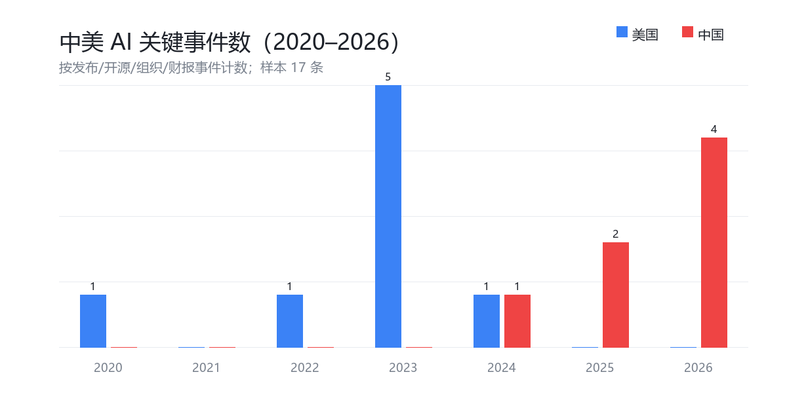
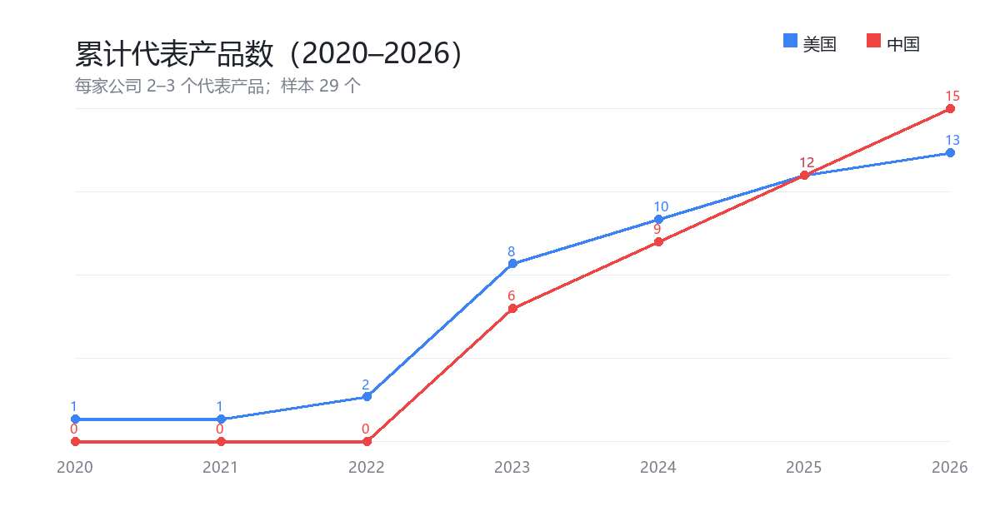

# AI 脉络 · 可视化模板（2026-11-20）

## 一、两张现成图

中美 AI 关键事件数（2020–2026），按发布/开源/组织/财报计数。

累计代表产品数（2020–2026），美国 13 个 / 中国 15 个。

本地文件：
- `D:\AI_Factory\reports\cases\chart_events.png`
- `D:\AI_Factory\reports\cases\chart_products.png`

## 二、可滚动对比的数据表

https://feishu.cn/base/TI5Lbesh1afNDHsSW0oclcsrn8f?table=tblq7CGBgT2cZMDK&view=vewu9mjDAr

字段：年份 / 国别 / 事件数 / 累计产品数 / 关键节点（14 行 = 7 年 × 2 国）。

## 三、在飞书里加图表（2 步）

1. 打开该多维表格 → 右上角「仪表盘」→ 新建
2. 添加图表 → 数据表选「滚动对比」：
   - 图 1：维度=年份，分组=国别，指标=事件数（柱状）
   - 图 2：维度=年份，分组=国别，指标=累计产品数（折线）

## 四、模板规范（以后每个主题照这个来）

| 图 | 类型 | 维度 | 指标 | 说明 |
|---|---|---|---|---|
| 1 | 分组柱状 | 年份 × 国别 | 事件数 | 看节奏 |
| 2 | 折线 | 年份 × 国别 | 累计产品数 | 看积累 |
| 3 | 条形 | 公司 | 评分 | 看排序（后续接公司表） |

## 五、边界

- 事件只有 17 条骨架，图形是「节奏示意」不是全史
- 产品计数按发布年份，未去重收购与合作产品
- 颜色固定：美国蓝、中国红，全库统一
